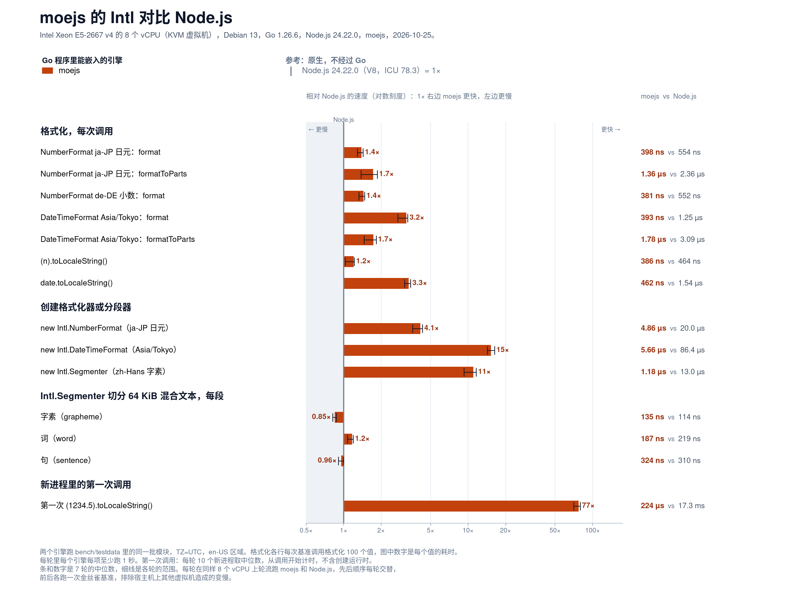
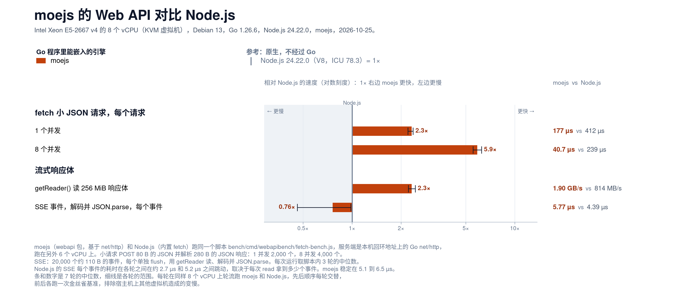
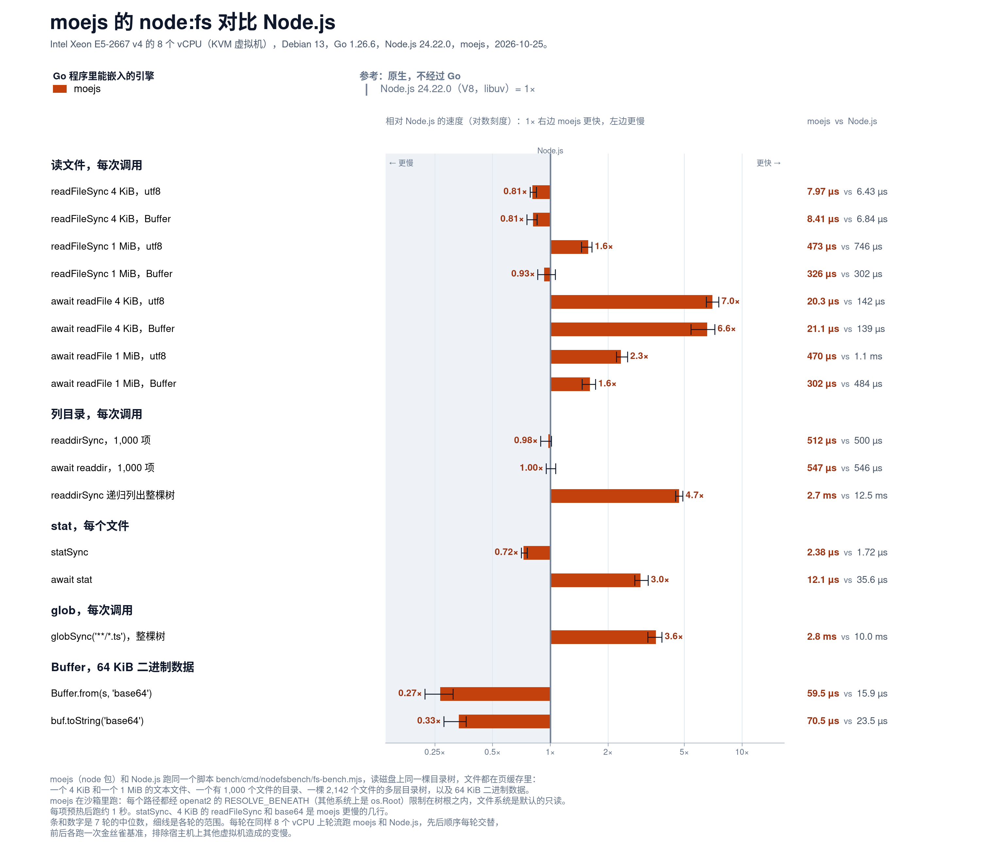

# moejs 性能

moejs 在其目标负载上与 Sobek、QuickJS、V8 的对比，以及如何复现这些数字。

[English](performance.md)

## 测试环境

除非某一节另有说明，以下数字均为 2026-10-01 测得的 5 次运行中位数：13th Gen Intel Core i5-13500H
（6 个性能核 + 6 个能效核，超线程到 16 个逻辑 CPU），Linux，go1.26.6 linux/amd64。
串行各行固定在 8 线程上（`taskset -c 0-7 GOMAXPROCS=8`）。测量时机器上还有别的负载，
10% 以内的差异按噪声看。
对比基线为 Sobek `v0.0.0-20260708062710`（纯 Go）、modernc.org/quickjs `v0.25.0`（翻译成纯 Go 的 QuickJS，2026-10-08 在同一台机器上测得）、quickjs-go `v0.7.7`（QuickJS，cgo）与 v8go `v0.9.0`（V8，cgo）。

负载是 new-api 的 10 个任务插件（6,358 行）与在 Sobek 上录制的 269 个钩子调用，其中 47 个会抛错。
所有测量都在 Go 调用方进行，包含参数与结果的转换。cgo 引擎以 JSON 文本传入传出，宿主用它们时也要付这部分成本。每次迭代都校验结果。

## 钩子调用

全部 269 个用例循环，单 goroutine，每次调用的均值：

| 引擎 | 耗时 | 分配字节 | 分配次数 |
|---|--:|--:|--:|
| **moejs** | **6.86 µs** | 4.7 KB | 30 |
| Sobek | 14.32 µs | 11.1 KB | 163 |
| modernc-quickjs | 35.16 µs | 5.4 KB | 100 |
| v8go | 56.64 µs ¹ | 5.3 KB | 104 |
| quickjs-go | 104.50 µs | 7.6 KB | 118 |

¹ v8go 的耗时在这台机器上波动很大，只能看量级。

moejs 的 30 次分配中有几次属于基准适配器本身：把参数和结果装箱成测试框架的接口类型。
`Runtime.Call` 本身不分配，其余分配来自插件创建的对象和值的转换。

## 宿主路径

`BenchmarkHostFlow`：同样的 269 个调用，加上 new-api 宿主在调用前后做的全部工作，每次调用的均值。
使用 Sobek 的 API 时，宿主要深拷贝每个参数（Sobek 以活引用包装 Go map），结果要经 `Export`、`json.Marshal`、
`json.Unmarshal` 解码到结构体。使用 moejs 时，宿主直接传入 map，再对 `AppendJSON` 的字节做 Unmarshal。
第二行从每个参数的 JSON 字节开始，对应宿主保存的任务数据（Sobek 用 `json.Unmarshal` + `ToValue`，moejs 用 `ParseJSON`）：

| 参数 | moejs | Sobek |
|---|--:|--:|
| Go 值 | 12.92 µs / 5.1 KB / 37 次分配 | 22.80 µs / 13.8 KB / 206 |
| JSON 字节 | 17.45 µs / 8.4 KB / 79 | 36.30 µs / 15.0 KB / 252 |

一次 10 KiB、JSON 形态的宿主往返（`identity(v) { return v }`，不读取任何属性），
moejs 为 177 ns / 6 次分配，Sobek 为 308 ns / 10 次分配，尽管 Sobek 的活代理 `ToValue`
在 JavaScript 读取字段之前不付任何代价。

## 运行时

新建运行时并注入 new-api 的宿主全局，再在其中求值插件模块。内存是每个存活运行时保留的 Go 堆：

| | moejs | Sobek | modernc-quickjs | quickjs-go | v8go |
|---|--:|--:|--:|--:|--:|
| 新建运行时 | 1.39 µs / 27 次分配 | 2.20 µs / 47 | 179.8 µs / 87 | 381.7 µs / 135 | 1152.7 µs ¹ / 54 |
| + 最大插件（alibaba） | 71.0 µs / 479 | 321.8 µs / 4,499 | 4,326 µs ² | 3,230 µs ² | 2,493 µs ¹ ² |
| + 最小插件（sora） | 7.0 µs / 81 | 37.6 µs / 672 | 1,124 µs ² | 1,070 µs ² | 1,349 µs ¹ ² |
| 保留内存，alibaba，512 个运行时 | 80.5 KiB | 263.6 KiB | 226.8 KiB ⁴ | 347.9 KiB ³ | 1,544 KiB ³ |
| 保留内存，sora，64 个运行时 | 11.8 KiB | 49.2 KiB | | | |

¹ v8go，见上方说明。² 含脚本编译，几个 QuickJS 引擎和 V8 按上下文编译。
³ 引擎自身的堆（QuickJS `malloc_size`、V8 已用堆大小）。⁴ 每个运行时让常驻内存增长了多少：modernc.org/quickjs 在 Go 堆之外分配内存，
也不统计正在用的字节。这个数字还受进程之前释放过的内存影响，所以较小的插件（在别的运行时关闭之后才测）没有列出。

编译最大的插件 moejs 需 2.2 ms、Sobek 需 2.6 ms，每个进程只需一次。使用 `Options{MutableIntrinsics: true}`
时，新建运行时需 35.9 µs，存活的 alibaba 运行时保留 229.4 KiB。

## 微基准

moejs 对比 Sobek，每次操作 100 次内循环：

| 用例 | moejs | Sobek | 加速比 | 分配次数（moejs / Sobek） |
|---|--:|--:|--:|--:|
| 属性读取，单态 | 6.4 µs | 18.9 µs | 2.9x | 9 / 96 |
| 属性读取，多态 | 6.6 µs | 13.3 µs | 2.0x | 8 / 11 |
| 函数调用 | 6.4 µs | 12.0 µs | 1.9x | 9 / 89 |
| 闭包 | 17.6 µs | 58.9 µs | 3.3x | 211 / 1,094 |
| 数组 push + for-of | 7.3 µs | 64.7 µs | 8.9x | 15 / 719 |
| 字符串拼接 | 20.7 µs | 34.5 µs | 1.7x | 399 / 712 |
| 字符串方法 | 181 µs | 791 µs | 4.4x | 909 / 11,811 |
| `JSON.parse` | 7.3 ms | 43.3 ms | 5.9x | 66k / 807k |
| `JSON.stringify` | 4.7 ms | 14.5 ms | 3.1x | 1,415 / 237k |
| `Object.keys` + `Object.assign` | 268 µs | 777 µs | 2.9x | 609 / 17,302 |
| RegExp test + replace | 193 µs | 552 µs | 2.9x | 2,210 / 9,503 |
| `new Error` + throw + catch | 30.2 µs | 72.8 µs | 2.4x | 300 / 1,393 |

## 插件场景


在 Go 程序能嵌入的几个引擎上跑 new-api 的插件负载，C 直接调用 QuickJS 的结果作为参考。2026-11-08 测量，moejs 为 2026-11-07 的源码。图里是 8 并发下的每秒请求数，以及单张 8 MiB 图在 32 并发时占用的内存；下面的表格有全部数字。`uv run --no-project --with matplotlib==3.11.2 bench/scripts/plugin_chart.py` 从 `docs/assets/plugin-bench.jsonl` 重画这张图（`--tables` 打印表格）。

- 机器是 Intel Xeon E5-2699A v4（Broadwell，2.4 GHz）上的 KVM 虚拟机，24 个 vCPU，每核单线程，16 MiB L3，测试进程绑定在其中 8 个 vCPU 上（taskset 0-7，GOMAXPROCS=8），Debian 13，Go 1.26.6，gcc 14.2。
- 每个 worker 一个运行时。一次调用把 JSON 字节交给引擎解析，调用插件，再把结果序列化成宿主自己的字节。每次预热 2 秒，小请求和 agent 请求测 6 秒，大请求测 8 秒，各次运行串行进行，引擎顺序每格轮换，每格 3 轮取中位数。
- 每次运行都记录绑定的 8 个 vCPU 上其他进程占用的 CPU 时间，平均超过四分之一个核就重跑。每次计时前都要通过 CPU 短探针；图片吞吐和内存测量还必须通过内存短探针，筛查宿主机上其他虚拟机的负载。比同一格另外两轮都慢 5% 以上的运行会重跑。
- 小请求是 new-api 10 个任务插件的 269 次真实调用。agent 请求是 8 个不同的编码会话，每个 10 万 token（o200k_base）：系统提示词、12 个工具定义、一条用户任务，以及 67 到 102 次工具调用的结果（Go 源码、grep 和测试输出）。agent 插件为本测试编写，接口和 new-api 任务插件的 buildSubmitRequest 一样：逐条转换消息，改模型名，给系统提示词加前缀，删掉上游不支持的参数和 JSON Schema 字段，返回 url、headers 和 body。大请求每次 25 MB 进、17 MB 出。
- 内存是所有 worker 停在最后一次调用写完输出时，Go 堆 GC 后的存活字节加 glibc malloc 正在用的字节，取 5 次快照中的最大值，包括 32 个运行时本身，不含等待回收的部分。
- quickjs-go v0.7.7 默认开启 goroutine 检查，每次 API 调用都要读一次 goroutine 栈，图里两种配置都测了。两种配置都用 JSON.stringify 输出，因为 Value.JSONStringify 会泄漏。Sobek 为 2026-07-08 版。
- modernc.org/quickjs v0.25.0 是用 modernc 工具链把 QuickJS 翻译成的纯 Go 代码，不需要 cgo。它没有 JSON 接口，参数以文本传入，在引擎里用 JSON.parse 解析、JSON.stringify 输出。它用自己的分配器，统计不到正在用的字节，所以没有内存数字。
- C 宿主用 gcc 14.2 编译，QuickJS 2026-06-04 用 -O2，quickjs-ng 0.15.1（quickjs-go 自带的那份）用 -O3。
- ParseJSONString 直接读调用方的字符串，这次调用的值还在用时，调用方不能改动这些字节。

每秒请求数，3 轮中位数：

| 场景 | 并发 | moejs（不拷贝） | moejs | Sobek | QuickJS 纯 Go（modernc） | quickjs-go 默认 | quickjs-go 关检查 | QuickJS（C） | quickjs-ng（C） |
|---|--:|--:|--:|--:|--:|--:|--:|--:|--:|
| 小请求 | 1 | 32,723 | 32,208 | 4,198 | 8,767 | 5,365 | 12,356 | 28,021 | 13,585 |
| 小请求 | 8 | 207,896 | 195,365 | 20,809 | 40,981 | 4,613 | 85,604 | 223,283 | 108,490 |
| 小请求 | 32 | 208,255 | 198,909 | 21,270 | 37,935 | 4,566 | 83,542 | 222,275 | 107,070 |
| 10 万 token agent 请求 | 1 | 963 | 878 | 83 | 92 | 131 | 133 | 255 | 186 |
| 10 万 token agent 请求 | 8 | 5,874 | 4,582 | 496 | 361 | 924 | 957 | 2,053 | 1,480 |
| 10 万 token agent 请求 | 32 | 6,407 | 5,104 | 488 | 341 | 869 | 928 | 1,967 | 1,424 |
| 单张 8 MiB 图 | 1 | 91.5 | 59.6 | 2.1 | 2.5 | 4.7 | 4.9 | 8.6 | 9.4 |
| 单张 8 MiB 图 | 8 | 578 | 204 | 15.7 | 12.4 | 34.9 | 34.6 | 67.2 | 69.1 |
| 单张 8 MiB 图 | 32 | 648 | 211 | 15.8 | 13.5 | 34.1 | 34.9 | 65.7 | 65.2 |
| 8 张 1 MiB 图 | 1 | 86.1 | 59.3 | 2.2 | 2.5 | 4.9 | 4.7 | 8.6 | 8.5 |
| 8 张 1 MiB 图 | 8 | 525 | 199 | 16.0 | 12.4 | 34.4 | 34.6 | 66.5 | 62.7 |
| 8 张 1 MiB 图 | 32 | 625 | 202 | 16.2 | 12.6 | 34.0 | 33.9 | 64.7 | 65.0 |

32 并发时真正占用的内存，单位 MiB（modernc 统计不到正在用的字节）：

| 场景 | moejs（不拷贝） | moejs | Sobek | QuickJS 纯 Go（modernc） | quickjs-go 默认 | quickjs-go 关检查 | QuickJS（C） | quickjs-ng（C） |
|---|--:|--:|--:|--:|--:|--:|--:|--:|
| 单张 8 MiB 图 | 380 | 1,148 | 1,101 | — | 1,111 | 1,110 | 1,138 | 1,140 |
| 8 张 1 MiB 图 | 362 | 1,130 | 1,104 | — | 1,110 | 1,111 | 1,138 | 1,141 |

## 通用 JavaScript：V8 benchmark suite v7


使用套件自带的 `run.js` 得分，越高越好；2026-11-07 在 Xeon E5-2699A v4 KVM 虚拟机上测量（24 个 vCPU，每核单线程，16 MiB L3），moejs 为 2026-11-07 的源码，Go 1.27.2，moejs 以 `-tags purego`、`CGO_ENABLED=0` 构建。每个引擎单线程运行，各自绑定一个 vCPU，`GOMAXPROCS=1`，引擎顺序轮换，3 轮取中位数。先确认并行运行对每个引擎得分的影响不超过 0.8%，再在独立 vCPU 上同时运行最多 8 个进程。

| 引擎 | 版本 | 得分 |
|---|---|--:|
| **moejs** | 2026-11-07 的源码 | **1,429** |
| QuickJS（C） | `2026-06-04` | 1,058 |
| go-quickjs | `github.com/go-quickjs/go-quickjs v0.28.0` | 999 |
| modernc | `modernc.org/quickjs v0.25.0` | 323 |
| goant | `github.com/robomotionio/goant v0.2.1` | 222 |
| goja | `github.com/dop251/goja v0.0.0-20261020172427-7b1a02208696` | 163 |
| Sobek | `github.com/grafana/sobek v0.0.0-20260708062710-267a0e055bb4` | 160 |

8 个程序各自的得分，取每个引擎总分居中的那一轮；每个总分都是它那一列的几何平均：

| 程序 | moejs | go-quickjs | modernc | goant | goja | Sobek | QuickJS（C） |
|---|--:|--:|--:|--:|--:|--:|--:|
| Richards | 1,019 | 581 | 199 | 140 | 142 | 143 | 779 |
| DeltaBlue | 826 | 588 | 220 | 145 | 161 | 162 | 696 |
| Crypto | 1,056 | 933 | 199 | 142 | 69.9 | 69.5 | 883 |
| RayTrace | 1,361 | 1,033 | 403 | 179 | 147 | 142 | 1,248 |
| EarleyBoyer | 2,003 | 1,221 | 530 | 281 | 237 | 232 | 1,655 |
| RegExp | 1,097 | 843 | 140 | 178 | 146 | 141 | 319 |
| Splay | 2,697 | 1,586 | 923 | 821 | 527 | 487 | 2,546 |
| NavierStokes | 2,422 | 1,844 | 491 | 275 | 118 | 118 | 1,949 |
| **总分** | **1,429** | **999** | **323** | **222** | **163** | **160** | **1,058** |

moejs 得分是 C QuickJS 的 1.35 倍。另一次固定运行全部 8 个程序的测试中，耗时从 v0.1.0-alpha.11 的 41.55 秒降至 14.29 秒，速度为原来的 2.9 倍。复现方法见 [V8 套件测试框架](../bench/race/README.md)。得分存在 `docs/assets/v8-bench.json`，`uv run --no-project --with matplotlib==3.11.2 bench/scripts/v8_chart.py` 先核对每个总分和它的各程序得分，再重画这张图（`--table` 打印上面的表格）。

## Intl



对比 Node.js 24.22（V8，ICU 78.3），2026-10-25 测量，Go 1.26.6，Intel Xeon E5-2667 v4（KVM 虚拟机，14 个 vCPU），绑定其中 8 个 vCPU。两个引擎跑 `bench/testdata` 里的同一批模块，TZ=UTC，en-US 区域：moejs 用 BenchmarkIntlFormat 和 BenchmarkIntlSegmenter，Node.js 用 `bench/scripts/intl_format_node.mjs` 和 `intl_node.mjs`。每个数字是 7 轮的中位数。每轮轮流跑 moejs 和 Node.js，先后顺序每轮交替，前后各跑一次金丝雀基准，排除宿主机上其他虚拟机的负载。

moejs 格式化的速度是 Node.js 的 1.2 到 3.3 倍，创建格式化器是 4 到 15 倍。Intl.Segmenter 按每段算是 Node.js 的：字素 0.85x，词 1.2x，句 0.96x。

每次调用的耗时，7 轮中位数。速度是 Node.js 的耗时除以 moejs 的耗时：

| 场景 | moejs | Node.js | 速度 |
|---|--:|--:|--:|
| NumberFormat ja-JP 日元，format | 398 ns | 554 ns | 1.4x |
| NumberFormat ja-JP 日元，formatToParts | 1.36 µs | 2.36 µs | 1.7x |
| NumberFormat de-DE 小数，format | 381 ns | 552 ns | 1.4x |
| DateTimeFormat Asia/Tokyo，format | 393 ns | 1.25 µs | 3.2x |
| DateTimeFormat Asia/Tokyo，formatToParts | 1.78 µs | 3.09 µs | 1.7x |
| `(n).toLocaleString()` | 386 ns | 464 ns | 1.2x |
| `date.toLocaleString()` | 462 ns | 1.54 µs | 3.3x |
| `new Intl.NumberFormat` | 4.86 µs | 20.0 µs | 4.1x |
| `new Intl.DateTimeFormat` | 5.66 µs | 86.4 µs | 15x |
| `new Intl.Segmenter` | 1.18 µs | 13.0 µs | 11x |
| Segmenter，每个字素 | 135 ns | 114 ns | 0.85x |
| Segmenter，每个词 | 187 ns | 219 ns | 1.2x |
| Segmenter，每个句子 | 324 ns | 310 ns | 0.96x |
| 新进程里第一次 `toLocaleString` | 224 µs | 17.3 ms | 77x |

`bench/scripts/intl_webapi_bench.sh` 编译基准并测新的几轮，`uv run --with matplotlib bench/scripts/intl_webapi_chart.py` 从 `docs/assets/intl-webapi-bench.jsonl` 重画这张图和下面的 Web API 图（`--table` 打印数字）。

## Web API



在 moejs 和 Node.js 24 里跑同一个 fetch 脚本，服务端在本机回环地址上，用 `bench/cmd/webapibench` 和 Intl 在同样的几轮里测量，时间是 2026-10-25。小请求和流式读响应体是 moejs 更快，SSE 是 moejs 更慢的一行。

## node:fs



moejs（`node` 包）和 Node.js 24.22 在同一棵文件树上跑同一个脚本 `bench/cmd/nodefsbench/fs-bench.mjs`，2026-10-25 和 Intl 的几轮一样测量，每个数字是 7 轮的中位数。moejs 在默认的沙箱里跑，每个路径都经 `openat2`（或 `os.Root`）限制在树根之内，文件系统只读。promise 形式、按文本读 1 MiB、递归列目录和 glob 是 moejs 更快，普通的 `readdir` 持平，`statSync`、小文件的 `readFileSync` 和 base64 是 moejs 更慢。

`OUT=docs/assets/nodefs-bench.jsonl sh bench/scripts/intl_webapi_bench.sh -sections nodefs` 测新的几轮，`uv run --with matplotlib bench/scripts/intl_webapi_chart.py` 从 `docs/assets/nodefs-bench.jsonl` 和另外两张图一起重画这张图（`--table` 打印数字）。

## 另一台机器

下面是 hanxi 为 [#1](https://github.com/MoeForge/moejs/pull/1)（把 modernc.org/quickjs 加进基准测试）测的数字：Intel Xeon E5-2650 v3（2 × 10 核，超线程到 40 个逻辑 CPU），
Linux，go1.26.0 linux/amd64，2026-10-08 测得的 3 次运行中位数。quickjs-go 用的是默认配置，没有测 V8。

| | moejs | Sobek | modernc-quickjs | quickjs-go |
|---|--:|--:|--:|--:|
| 一次插件调用 | 21.4 µs / 4.8 KB / 29 | 45.8 µs / 11.3 KB / 163 | 111.6 µs / 5.4 KB / 100 | 316 µs / 7.8 KB / 118 |
| 新建运行时 | 4.27 µs | 6.17 µs | 556 µs | 1,126 µs |
| + 最大插件（alibaba） | 247 µs | 931 µs | 10,666 µs | 7,530 µs |
| + 最小插件（sora） | 22.2 µs | 111 µs | 2,944 µs | 2,694 µs |
| 保留内存，alibaba，512 个运行时 | 75.7 KiB | 264.2 KiB | 456 KiB ¹ | 347.9 KiB ² |

¹ 常驻内存的增长。² 引擎自身的堆。

## 复现

基准测试位于 `bench/`，运行的是 new-api 的插件，由 `bench/testdata/plugins/fetch.sh` 按固定提交下载：

```sh
bench/testdata/plugins/fetch.sh
cd bench
go test -run xxx -bench 'Benchmark(HookSuite|HostFlow|NewRuntime|Instantiate|Compile|Micro)$' -benchmem -count 5 .
go test -run TestFootprint -v .
```

`bench/scripts/run_all.sh` 运行全部测量，包括并发吞吐与分阶段基准。

插件场景由 `bench/cmd/pluginbench` 运行。`bench/scenarios/gen.py` 把输入生成到 `bench/testdata/scenarios`（不纳入 git），并用 `bench/scenarios/SHA256SUMS` 校验，这些哈希就是上面数据测量时所用文件的哈希。输入都不作为数据保存：小请求来自 `bench/testdata/fixtures` 里的调用，图片是固定种子生成的随机字节，agent 会话里的工具结果取自 Go 1.26.6 源码树，gen.py 通过 `GOTOOLCHAIN=go1.26.6 go env GOROOT` 找到它。运行前需要先下载插件，并装有 Python 3.9 或更高版本：

```sh
python3 bench/scenarios/gen.py
cd bench
go run ./cmd/pluginbench -engine moejs -scenario agent100k -workers 8
```

`bench/scripts/plugin_ab.sh <base> <head>` 先确认两边结果相同，再用两个 git 版本或两份检出的 moejs 跑这些场景。C 版 QuickJS 和 quickjs-ng 两列来自一个不在仓库里的 C 宿主程序。

## PGO

`default.pgo` 以整套钩子负载录制（在 `bench/` 中运行 `go run -trimpath ./cmd/pgo` 重新生成）。Go 只会自动使用 main 包目录下的
`default.pgo`，因此嵌入方需要传入 `-pgo=<moejs 路径>/default.pgo`，或把该文件复制到自己的 main 包目录。
